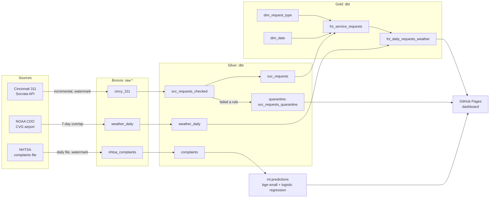

# Nightly 311 pipeline

A small production-style data pipeline that runs every night on GitHub Actions, for $0.

It pulls **Cincinnati 311 service requests** and **NOAA weather** into a DuckDB warehouse, lands them unchanged (bronze), cleans and tests them with dbt (silver), models them into a star schema (gold), and routes rows that break a data quality rule to a **quarantine** table with the reason. Alongside it, an open-source **complaint classifier** reads new NHTSA vehicle safety complaints and predicts which part of the car each one is about, and it is scored every night against NHTSA's own labels.

**Live dashboard:** https://sidantap.github.io/nightly-311-pipeline/

## Architecture



One nightly run (`python -m pipeline.run`):

| Step | What happens |
|---|---|
| **ingest** | Each source is read incrementally from its watermark, minus an overlap, and appended to `raw.*` with a batch id and ingest time. A watermark moves only after its load commits, so a failed run is simply retried the next night. |
| **transform** | `dbt seed`, `dbt source freshness`, then `dbt build` for staging, silver and quarantine, with tests. |
| **classify** | New complaints are embedded and classified, then the model is scored on the last 30 days of labeled complaints. |
| **publish** | `dbt build` for gold, with tests. |
| **export** | Dashboard numbers are written to `site/data.json` and deployed to GitHub Pages. |

The DuckDB file is carried between runs as a GitHub Release asset, so the whole thing needs no database server and no cloud account.

## Design decisions

**Land first, fix later.** Bronze tables keep every version of every row exactly as it arrived. A 311 request changes after it's created (status, close date), so silver keeps the latest version per `sr_number`. If a number looks wrong, bronze shows what the source actually sent.

**Overlapping incremental windows.** 311 updates are only dated to the day, and NOAA revises recent observations, so each run re-reads a window behind its watermark (2 days for 311, 7 for weather, 3 for NHTSA). Silver deduplicates, so re-reading is safe and re-running a night never double-counts.

**Quarantine, don't drop.** `svc_requests_checked` gives each request a `dq_reason`: missing id, missing created date, closed before it was created, created in the future, missing location, or a location outside the city. Clean rows go to `silver.svc_requests`, and the rest go to `quarantine.svc_requests_quarantine` with the reason. A warning test fires if more than 5% of rows are quarantined, because that usually means the source changed shape.

**Tests found real data issues.** The relationship test from the fact table to `dim_date` failed on its first run. Request `SR17037967` was created in 2017 and was still being updated in October 2026, so the date dimension now starts at the earliest date in the data instead of a fixed year.

**Labels live in one place.** NHTSA's raw component names map to 13 groups in `dbt/seeds/component_groups.csv`. dbt and the training script both read that file, so they can't disagree about what a label means.

## The complaint classifier

Cincinnati's public 311 data has no free-text description, so the AI step uses NHTSA vehicle complaints instead. Those have a written description and an official component tag, which serves as the answer key.

- **Model:** `BAAI/bge-small-en-v1.5` sentence embeddings (an open model, about 130 MB, runs on CPU), followed by a class-balanced logistic regression.
- **Labels:** complaints tagged with exactly one component, mapped to groups.
- **Split:** time-based. It trains on complaints received before 2026-07-01 and tests on complaints received after, which is how it is used in production and stricter than a random split.
- **Scored nightly:** every new complaint is classified before its label is looked at, and the dashboard shows accuracy over the last 30 days.

Offline results on the held-out test set are in [`ml/artifacts/offline_metrics.json`](ml/artifacts/offline_metrics.json) and on the dashboard.

Retrain with `python -m ml.train`. It downloads NHTSA's current file and writes `ml/artifacts/`.

## Run it locally

```bash
python -m venv .venv && . .venv/bin/activate
pip install -r requirements.txt
export NOAA_TOKEN=...            # free from https://www.ncdc.noaa.gov/cdo-web/token (optional locally)
export BACKFILL_DAYS=7 NHTSA_BACKFILL_DAYS=7   # small first load
python -m pipeline.run
python -m http.server -d site    # dashboard at http://localhost:8000
```

## Layout

```
pipeline/   ingestion, orchestration, dashboard export
dbt/        staging, silver, quarantine and gold models, seeds and tests
ml/         classifier training, nightly prediction and scoring
site/       static dashboard (GitHub Pages)
.github/    nightly workflow
```

## Data sources

- City of Cincinnati, [311 (Non-Emergency) Service Requests](https://data.cincinnati-oh.gov/Thriving-Neighborhoods/Cincinnati-311-Non-Emergency-Service-Requests/gcej-gmiw)
- NOAA NCEI [Climate Data Online](https://www.ncdc.noaa.gov/cdo-web/), GHCND station USW00093814 (CVG)
- NHTSA [vehicle complaints flat files](https://static.nhtsa.gov/odi/ffdd/cmpl/)

Built by [Sidanta Parajuli](https://sidantap.github.io/portfolio/).
